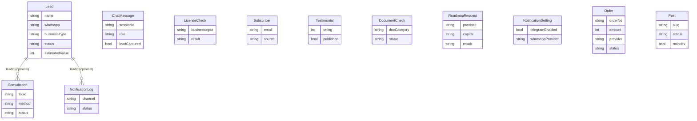
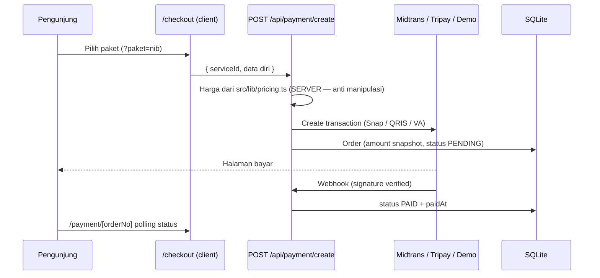

<div align="center">


# PUSATPERIZINAN.COM

**Urus Semua Izin Usaha, Tinggal Terima Beres.**

*Website + Lead Generation Engine + AI Consultant 24/7 untuk Konsultan Perizinan, Perpajakan & Penempatan PMI #1 Indonesia*


</div>

---

> 🏛️ **Identitas resmi:** PT Digital Bisnis Manajemen · Kantor: Indonesia Stock Exchange Building, Tower 2, Lt. 5, SCBD Lot 13, Jakarta Selatan · Cabang: Bandung
> 📞 **WhatsApp:** 0812-6999-9910 · ✉️ **Email:** halo@pusatperizinan.com · 🕐 **Jam:** Senin–Sabtu 08.00–20.00 WIB
> ⭐ **Trust metrics (sumber tunggal `src/lib/site.ts`):** rating 4,9/5 dari 890 ulasan · 1.247 klien · 3.890 izin diproses · 38 provinsi · 514 kabupaten/kota

---

## 📑 Daftar Isi

- [1. Tentang Proyek](#1-tentang-proyek)
- [2. Fitur Lengkap](#2-fitur-lengkap)
- [3. Tech Stack](#3-tech-stack)
- [4. Quick Start](#4-quick-start)
- [5. Struktur Direktori](#5-struktur-direktori)
- [6. Arsitektur & 3 Mode Deployment](#6-arsitektur--3-mode-deployment)
- [7. Peta Rute Lengkap (30+ Halaman)](#7-peta-rute-lengkap-30-halaman)
- [8. API Reference (30+ Endpoint)](#8-api-reference-30-endpoint)
- [9. Database — 12 Model Prisma](#9-database--12-model-prisma)
- [10. Internasionalisasi — 30 Bahasa](#10-internasionalisasi--30-bahasa)
- [11. Mesin SEO & GEO](#11-mesin-seo--geo)
- [12. Design System & Motion](#12-design-system--motion)
- [13. Arsitektur Navigasi (5 Grup)](#13-arsitektur-navigasi-5-grup)
- [14. Panel Admin — Mission Control](#14-panel-admin--mission-control)
- [15. Panel Deploy & Folder /download](#15-panel-deploy--folder-download)
- [16. Sistem Pembayaran](#16-sistem-pembayaran)
- [17. Notifikasi Real-Time (Telegram/WhatsApp)](#17-notifikasi-real-time-telegramwhatsapp)
- [18. Environment Variables](#18-environment-variables)
- [19. Scripts & Perintah](#19-scripts--perintah)
- [20. Gateway & Layanan Mini](#20-gateway--layanan-mini)
- [21. Kualitas, Testing & Verifikasi](#21-kualitas-testing--verifikasi)
- [22. Troubleshooting — Pelajaran Lapangan](#22-troubleshooting--pelajaran-lapangan)
- [23. Riwayat Pengembangan (Task 1–14)](#23-riwayat-pengembangan-task-114)
- [24. Roadmap](#24-roadmap)
- [25. FAQ Developer](#25-faq-developer)
- [26. Kontribusi](#26-kontribusi)
- [27. Kredit & Lisensi](#27-kredit--lisensi)

---

## 1. Tentang Proyek

**PusatPerizinan.com** adalah situs web produksi untuk jasa konsultan perizinan usaha Indonesia — bukan sekadar landing page, melainkan **mesin lead generation penuh** yang menggabungkan:

| Dimensi | Isi |
|---|---|
| 🎯 **Bisnis** | Jasa pengurusan NIB, pendirian PT/CV/PMA, sertifikasi halal, izin BPOM/PIRT, PBG/SLF, AMDAL, izin umroh (PPIU/PPIH), IATA, MISA Arab Saudi, RKAB tambang, pajak & kepatuhan |
| 📄 **Konten** | **10.706 URL** terindeks sitemap (13 seksi): 500 halaman layanan detail, 500 Katalog Premium PP-XXX, 36 KBLI, 15+ artikel blog, matriks industri, halaman biaya/syarat/perbandingan, 16 panduan + hub, 4 halaman dedikasi CTA (konsultasi/cek-izin/kalkulator/panduan) |
| 🤖 **AI** | 5 tool AI aktif: Cek Izin AI, AI Consultant "RIZKI" 24/7, Cek Dokumen (vision), AI Roadmap 12 bulan, kalkulator pajak |
| 🌍 **Internasional** | UI **30 bahasa** (termasuk RTL penuh: Arab, Farsi, Urdu, Ibrani) + `llms.txt` siap GEO/AI-search |
| 💰 **Monetisasi** | Checkout otomatis (Midtrans/Tripay) dengan harga server-side anti-manipulasi + mode demo |
| 🛠️ **Operasional** | Admin "Mission Control" untuk leads, orders, CMS blog, konsultasi, notifikasi |
| 🚀 **Deploy** | 3 mode: dev (Turbopack), standalone (Node), **static export siap cPanel shared hosting** |

### Mengapa proyek ini unik

1. **500 halaman layanan programatik** dari satu dataset JSON (`src/data/layanan-500.json`) — masing-masing dengan metadata SEO unik, JSON-LD 4 tipe schema, harga kupon bertingkat, dan FAQ spesifik.
2. **SEO-first sampai ke tulang**: sitemap index 12 seksi dengan `lastmod` deterministik, `robots.txt` GEO-ready, RSS feed, HTML sitemap di beranda, dan JSON-LD di hampir setiap halaman.
3. **Bisa jalan di hosting shared murah**: pipeline build khusus meng-export seluruh situs jadi HTML murni (tanpa Node.js) — lengkap dengan panel download yang menjamin artefak **selalu versi terbaru**.

---

## 2. Fitur Lengkap

### 🏠 Landing Page (23 section berurutan di `src/app/page.tsx`)

| # | Section | Fungsi |
|---|---|---|
| 1 | `Hero` | Form Konsultasi Gratis (lead capture #1) + aurora ambient + koreografi entrance 5 babak |
| 2 | `StatsBar` | 4 metrik trust (entrance CSS murni) |
| 3 | `GovernmentChannels` | Seal kanal resmi: OSS, AHU, Coretax, BPJPH, BPOM, DPMPTSP |
| 4 | `Services` | 36 layanan inti (stagger grid 3 kolom) |
| 5 | `TaxServices` | Layanan perpajakan (NPWP, PKP, LKPM) |
| 6 | `WorkAbroad` | Penempatan PMI (Jepang/Korea/Arab) |
| 7 | `VirtualOfficeSection` | Virtual office 48 lokasi / 30 kota |
| 8 | `CertificationsSection` | Sertifikasi & mutu |
| 9 | `CatalogTeaser` | Pengantar Katalog 500 |
| 10 | `LicenseChecker` | **Cek Izin AI** — deskripsi usaha → rekomendasi izin |
| 11 | `CostCalculator` | Kalkulator biaya interaktif |
| 12 | `KnowledgeHub` | Hub panduan perizinan |
| 13 | `BlogHub` | Teaser artikel terbaru |
| 14 | `EmailCourse` | Kursus email 7 hari (lead nurturing) |
| 15 | `CoverageSection` | Peta jangkauan 38 provinsi / 514 kota |
| 16 | `WhyUs` | 6 pembeda + garansi 100% |
| 17 | `OfficeGallery` | **5 foto kantor asli** Jakarta SCBD & Bandung (bukti E-E-A-T) |
| 18 | `Process` | Alur 4 langkah kerja |
| 19 | `Pricing` | 3 tier paket |
| 20 | `Testimonials` | Testimoni klien |
| 21 | `TeamSection` | Tim konsultan |
| 22 | `Comparison` | Perbandingan vs urus sendiri |
| 23 | `Faq` → `FinalCta` → `HtmlSitemap` | FAQ + CTA akhir + peta situs HTML |

Plus global: `Header` (menu 5 grup), `Footer` (credit "Support system by PT Top Konsultan Internasional — McKinsey Partner Indonesia"), `ChatWidget` (RIZKI), `AdminDeploy` (privat, `/?admin=1`).

### 🤖 5 Tool AI (backend `z-ai-web-dev-sdk`, hanya server-side)

| Tool | Route | Model DB | Mekanisme lead |
|---|---|---|---|
| Cek Izin AI | `POST /api/license-checker` | `LicenseCheck` | Hasil gratis, laporan lengkap minta WA |
| Chatbot RIZKI | `POST /api/chat` | `ChatMessage` | Deteksi intent → capture lead dalam chat |
| Cek Dokumen | `POST /api/document-checker` | `DocumentCheck` | Upload foto dokumen → analisis vision → WA untuk laporan |
| AI Roadmap 12 bulan | `POST /api/roadmap` | `RoadmapRequest` | Wizard → roadmap PDF-plan → follow-up |
| Kalkulator Pajak | `/kalkulator-pajak` (client-side) | — | Interaktif, funnel ke konsultasi |

### 📦 Sistem Konten & CMS

- **Katalog 500 Layanan** — pencarian instan, filter 4 kategori (BU/LH/KP/SK) & 38 sub-kategori, load-more, deep-link hash, unduh PDF lead magnet.
- **Blog hybrid** — 15 artikel statis (`src/lib/blog-content.ts`) + artikel dinamis dari DB (`Post` model); DB menang bila slug sama.
- **FAQ 51 Q&A** — 10 kategori, pencarian lintas bahasa, deep-link `#qid` shareable.
- **Editor CMS** admin dengan skor SEO live (metaTitle/metaDescription/focusKeyword/noindex).

### 💳 Checkout & Pembayaran

- `/checkout?paket=<id>` → `POST /api/payment/create` → harga **selalu** dari `src/lib/pricing.ts` di server (client tidak pernah mengirim angka).
- Provider: **Midtrans** (Snap), **Tripay** (QRIS/VA/e-wallet), **Demo** (simulasi tanpa uang nyata), Manual.
- Nomor order `INV-YYYYMMDD-XXXXXX`; webhook `midtrans` & `tripay`; halaman status `/payment/[orderNo]`.

---

## 3. Tech Stack

| Lapisan | Teknologi | Catatan |
|---|---|---|
| Framework | **Next.js 16.1.3** (App Router, Turbopack) | `output: "standalone"`, opsi `output: "export"` via `BUILD_STATIC=1` |
| Bahasa | **TypeScript 5** (strict) | `tsconfig` strict; path alias `@/*` → `src/*` |
| UI | **React 19** + **Tailwind CSS 4** + **shadcn/ui** (New York, base neutral) | 48 komponen UI di `src/components/ui`; ikon **Lucide** |
| Animasi | **framer-motion 12** + CSS compositor-only | `MotionProvider` global (`reducedMotion="user"`) |
| Database | **Prisma 6.11** + **SQLite** (`db/custom.db`) | `prisma db push` alur utama |
| State | Zustand (client) · TanStack Query (server state) | Terpasang, dipakai selektif |
| Form | react-hook-form + zod 4 | Validasi dua sisi |
| AI SDK | **z-ai-web-dev-sdk** | **WAJIB hanya di backend** (API routes) |
| Payment SDK | Midtrans Snap · Tripay REST | Mode demo via `PAYMENT_DEMO_MODE` |
| Lainnya | next-themes, sonner, embla-carousel, recharts, next-intl (pasif) | Lihat `package.json` (67 dependencies) |
| Runtime | **Bun** (dev & tooling) | `bun run dev` di port **3000** |
| Gateway | **Caddy** (`:81`) | Routing `XTransformPort` → layanan internal |

---

## 4. Quick Start

```bash
# 1. Install dependency
bun install

# 2. Siapkan environment (lihat §18 untuk daftar lengkap)
cat > .env <<'EOF'
DATABASE_URL=file:/home/z/my-project/db/custom.db
ADMIN_PASSWORD=<password-admin-anda>
ADMIN_SECRET=<secret-acak-min-32-karakter>
PAYMENT_DEMO_MODE=true
EOF

# 3. Push schema ke database
bun run db:push

# 4. Jalankan dev server (OOM-safe — lihat §22)
NODE_OPTIONS="--max-old-space-size=2560" bun run dev > dev.log 2>&1 &

# 5. Buka
#    Situs    → http://localhost:3000
#    Admin    → http://localhost:3000/admin
#    Panel    → http://localhost:3000/?admin=1  (panel deploy)
```

> ⚠️ **Preview sandbox:** gunakan **Preview Panel** di kanan antarmuka (atau tombol *"Open in New Tab"*) — jangan `localhost` langsung.

### Verifikasi instalasi sehat

```bash
curl -s -o /dev/null -w "%{http_code}" http://localhost:3000/          # 200
curl -s -o /dev/null -w "%{http_code}" http://localhost:3000/sitemap.xml  # 200 (XML index)
curl -s http://localhost:3000/api/stats                                 # JSON statistik
bun run lint                                                            # 0 error
tail -f dev.log                                                         # pantau runtime
```

---

## 5. Struktur Direktori

```text
pusatperizinan/
├── src/
│   ├── app/                        # App Router — 35+ route
│   │   ├── page.tsx                # Beranda (23 section)
│   │   ├── layout.tsx              # Metadata SEO supercharged + MotionProvider + LanguageProvider
│   │   ├── not-found.tsx           # 404 branded
│   │   ├── [slug]/                 # ★ 500 halaman layanan programatik
│   │   ├── layanan/                # Hub layanan + [...slug] detail
│   │   ├── katalog/                # Katalog 500 (browser interaktif + [kategori])
│   │   ├── kbli/                   # Klasifikasi KBLI (browser + [...slug])
│   │   ├── blog/                   # Blog hybrid (statis + CMS) + [slug]
│   │   ├── faq/                    # FAQ 51 Q&A (browser + JSON-LD)
│   │   ├── kebijakan-privasi/      # v2.0 UU PDP 27/2022 + GDPR-grade (17 seksi, 30 bahasa)
│   │   ├── syarat/ · syarat-ketentuan/ · panduan/[id]/
│   │   ├── biaya/ · bandingkan/ · paket/ · paket-usaha/
│   │   ├── industri/               # Matriks industri → [slug] → [slug]/[service]
│   │   ├── roadmap/ · kalkulator-pajak/ · cek-dokumen/   # 3 tool AI (halaman)
│   │   ├── virtual-office/ · solusi-korporat/ · pma-company-registration/ · bumdes/
│   │   ├── tentang-kami/ · kontak/ · testimoni/[kategori]/ · lowongan-kerja/[slug]/
│   │   ├── mitra/ · kanal-resmi/ · kalender-kepatuhan/
│   │   ├── checkout/               # Form checkout (?paket=)
│   │   ├── payment/[orderNo]/      # Status & instruksi bayar
│   │   ├── admin/                  # ★ Mission Control (login HMAC cookie)
│   │   ├── sitemap/[id]/route.ts   # 12 seksi sitemap XML
│   │   ├── feed.xml/route.ts       # RSS blog
│   │   ├── llms-full.txt/route.ts  # GEO: konten penuh untuk AI crawler
│   │   └── api/                    # ★ 30+ endpoint (lihat §8)
│   ├── components/
│   │   ├── landing/                # 32 komponen landing (hero, header, chat-widget, admin-deploy, …)
│   │   ├── admin/                  # 13 modul Mission Control (leads, orders, cms, …)
│   │   ├── ui/                     # 48 shadcn/ui (New York)
│   │   ├── motion/                 # MotionProvider + Reveal/RevealScale
│   │   ├── payment/ · seo/ · program/ · institutions/ · testimonials/
│   │   └── lead-form.tsx           # Form lead reusable
│   ├── lib/
│   │   ├── site.ts                 # ★ SINGLE SOURCE OF TRUTH (URL, NAP, trust metrics)
│   │   ├── pricing.ts              # ★ Sumber harga checkout (server-side)
│   │   ├── db.ts                   # Prisma client singleton
│   │   ├── admin-auth.ts           # HMAC-SHA256 cookie auth
│   │   ├── notify.ts               # Telegram / Fonnte / Wablas
│   │   ├── layanan-500.ts + data/layanan-500.json   # Dataset 500 layanan
│   │   ├── blog-content.ts · blog-cms.ts             # Blog statis + CMS merge
│   │   ├── faq-data.ts · privacy-content.ts          # Konten i18n (30 bahasa)
│   │   ├── i18n/                   # Registry bahasa + 6 file terjemahan
│   │   ├── catalog/ · seo-pages/ · seo.ts · sitemap-sections.ts
│   │   ├── payment/                # config · midtrans · tripay · orders
│   │   └── kbli-*.ts · geo.ts · landing-data.ts · …
│   └── hooks/                      # use-toast, use-mobile
├── prisma/schema.prisma            # 12 model (lihat §9)
├── db/custom.db                    # SQLite (data seeded)
├── public/
│   ├── kantor/                     # 5 foto kantor resmi (dioptimasi sharp, q82)
│   ├── download/                   # ★ Artefak unduhan (pack, PDF, pack-info.json)
│   ├── logo.png · logo-icon.png · og-pusatperizinan.png
│   └── robots.txt · llms.txt · manifest.json · favicon.svg
├── scripts/
│   ├── build-static.mjs            # Pipeline export (PACK_LIGHT / FULL) + SEO post-proses
│   ├── deploy-pack.mjs             # Pack artefak + pack-info.json schema v2
│   ├── seo-audit.ts · postbuild.mjs · remote-setup.sh · process-logo.mjs
├── upload/                         # Aset mentah user (foto kantor asli, PDF katalog, dataset)
├── docs/                           # SEARCH-CONSOLE-ANALYTICS.md · SCRIPT-60-DETIK.md
├── examples/websocket/             # Demo socket.io (gateway XTransformPort)
├── DEPLOY-IDWEBHOST.md             # Panduan deploy cPanel step-by-step
├── .htaccess                       # Untuk paket hosting statis (GZIP, cache, 404)
├── Caddyfile                       # Gateway sandbox (:81, XTransformPort)
├── worklog.md                      # Log pengembangan Task 1–10 (transparan penuh)
└── README.md                       # ← file ini
```

---

## 6. Arsitektur & 3 Mode Deployment

### Alur data makro

```mermaid
flowchart LR
    subgraph Pengunjung
        A[Landing / Tool AI / Blog]
    end
    subgraph Next.js API Routes
        B[/api/leads · /api/chat · /api/license-checker/]
        C[/api/payment/*]
        D[/api/admin/*]
    end
    subgraph AI
        E[z-ai-web-dev-sdk<br/>LLM · Vision]
    end
    subgraph Data
        F[(Prisma 6<br/>SQLite custom.db)]
    end
    subgraph Notifikasi
        G[Telegram Bot<br/>Fonnte / Wablas]
    end
    A --> B
    B --> E
    B --> F
    F --> G
    C --> F
    D --> F
```

### Tiga mode output (satu codebase)

| Mode | Trigger | Output | Dipakai untuk |
|---|---|---|---|
| **Dev** | `bun run dev` | Standalone + Turbopack, HMR | Pengembangan sandbox (port 3000) |
| **Standalone** | `bun run build` → `bun start` | `.next/standalone/server.js` (Node) | VPS / Passenger cPanel |
| **Static Export** | `BUILD_STATIC=1 bun run build` (via `scripts/build-static.mjs`) | Folder `out/` — HTML+CSS+JS murni | **Shared hosting idwebhost (cPanel)** |

Poin arsitektur penting:

1. **Sitemap**: `next.config.ts` rewrite `/sitemap.xml → /api/sitemap-index` (hanya mode non-export — `output:"export"` tidak mendukung rewrites; mode statis mendapat `out/sitemap.xml` hasil post-proses build).
2. **Patch sementara saat export**: `build-static.mjs` mem-patch 5 file route (`dynamicParams: false`) untuk memenuhi syarat literal statis Next.js, lalu **dipulihkan otomatis** di `finally` — source tree selalu kembali utuh.
3. **Refactor permanen hasil export**: `/checkout` kini pre-renderable di semua mode (CheckoutFromQuery + Suspense); `/blog/[slug]` bebas-`cookies()` saat `BUILD_STATIC`.
4. **Canonical host**: `https://pusatperizinan.com` (apex, HTTPS, tanpa www) — didefinisikan sekali di `src/lib/site.ts`, semua varian di-301.

---

## 7. Peta Rute Lengkap (30+ Halaman)

### Halaman publik statis

| Rute | Deskripsi |
|---|---|
| `/` | Beranda — 23 section + panel deploy privat |
| `/layanan` | Hub semua layanan (+ rail `[...slug]` halaman layanan lanjutan) |
| `/katalog` | Katalog **1.000 layanan**: 500 resmi (4 kategori) + **500 Premium PP-XXX edisi Terlengkap Se-Asia** (6 kategori, search/filter/sort) · `/katalog/[kategori]` kategori klasik 31 divisi · detail premium: `/layanan/{slug}-pp-{cat}-{nnn}` |
| `/kbli` | Pencarian KBLI · `/kbli/[...slug]` detail kode |
| `/blog` · `/blog/[slug]` | Daftar + artikel (statis + CMS) |
| `/faq` | 51 Q&A, 10 kategori, pencarian multi-bahasa |
| `/paket` · `/paket-usaha` · `/biaya` (+`/[slug]`) · `/bandingkan` (+`/[slug]`) | Harga & perbandingan |
| `/syarat` (+`/[slug]`) · `/panduan/[id]` | Syarat per layanan + panduan |
| `/industri` · `/industri/[slug]` · `/industri/[slug]/[service]` | Matriks industri → layanan |
| `/roadmap` · `/kalkulator-pajak` · `/cek-dokumen` | Halaman 3 tool AI |
| `/konsultasi` · `/cek-izin` · `/kalkulator` · `/panduan` (+`/[id]`) | ★ **Halaman dedikasi CTA (Task 12)** — form konsultasi, cek izin (tool), kalkulator biaya (tool), hub 16 panduan |
| `/virtual-office` · `/solusi-korporat` · `/pma-company-registration` · `/bumdes` | Solusi spesialis |
| `/mitra` | ★ **Program Kemitraan Cabang Resmi** (Task 13) — 3 tier (Gerai/Cabang Resmi/Master Franchise), simulasi profit interaktif, 10 FAQ, JSON-LD Service+Offer+FAQPage |
| `/tentang-kami` · `/kontak` · `/testimoni` (+`/[kategori]`) · `/lowongan-kerja` (+`/[slug]`) | Profil & sosial |
| `/kanal-resmi` · `/kalender-kepatuhan` | Kanal pemerintah + kalender pajak/laporan |
| `/kebijakan-privasi` · `/syarat-ketentuan` | Legal (privasi v2.0, 30 bahasa) |
| `/checkout` · `/payment/[orderNo]` | Funnel pembayaran |
| `/[slug]` | ★ **500 halaman layanan programatik** (mis. `/jasa-pendirian-pt-lokal`) — slug asing → 404 |

### Halaman privat & infra

| Rute | Deskripsi |
|---|---|
| `/admin` | Mission Control (login password → cookie HMAC 12 jam) |
| `/?admin=1` | Panel AdminDeploy (unduh paket hosting terbaru) |
| `/sitemap.xml` | Sitemap index (rewrite → `/api/sitemap-index`) |
| `/sitemap/[id].xml` | 12 seksi (static, layanan, blog, katalog, kbli, dst.) |
| `/feed.xml` | RSS blog |
| `/llms-full.txt` | Konten penuh untuk AI crawler (GEO) |
| `/*/404` | Halaman 404 branded sitewide |

---

## 8. API Reference (30+ Endpoint)

Semua endpoint berada di `src/app/api/**/route.ts`. AI endpoints **wajib server-side** (SDK `z-ai-web-dev-sdk` tidak pernah dikirim ke client).

### Publik — Lead & Engagement

| Metode | Endpoint | Fungsi |
|---|---|---|
| `GET` | `/api` | Health check (`{ message }`) |
| `POST` | `/api/leads` | Simpan lead baru (WA dinormalisasi ke `62xxx`, deteksi `source`) · Validasi ketat: `businessType` ∈ SECTORS, `package` ∈ PACKAGES (UMKM/Bisnis/Enterprise/Belum tahu) — client wajib kirim nilai resmi (fix Task 12) · `GET` untuk statistik ringkas |
| `POST` | `/api/subscribe` | Pendaftar kursus email 7 hari |
| `GET` | `/api/stats` | Statistik agregat (leads, konsultasi, dll.) untuk social proof |
| `POST` | `/api/vitals` · `GET` | RUM Core Web Vitals (LCP/CLS/INP) — laporan `GET /api/vitals` |
| `POST` | `/api/chat` | Chatbot RIZKI — instruksi bahasa dinamis sesuai 30 bahasa pengguna |
| `POST` | `/api/license-checker` | Analisis deskripsi usaha → rekomendasi izin (JSON `result` tersimpan) |
| `POST` | `/api/document-checker` | Upload foto dokumen (multipart) → analisis vision per kategori (`auto`, `npwp`, `nib`, `ktp`, `paspor`, …) |
| `POST` | `/api/roadmap` | Generator roadmap bisnis 12 bulan (bidang, provinsi, skala, modal, rencana) |

### Publik — Pembayaran

| Metode | Endpoint | Fungsi |
|---|---|---|
| `GET` | `/api/payment/config` | Konfigurasi provider aktif + mode demo (tanpa bocor secret) |
| `POST` | `/api/payment/create` | Buat order — **harga dihitung server-side dari `pricing.ts`** |
| `GET` | `/api/payment/status/[orderNo]` | Polling status order |
| `POST` | `/api/payment/demo-pay` | Simulasi pembayaran (hanya `PAYMENT_DEMO_MODE=true`) |
| `POST` | `/api/payment/webhook/midtrans` | Webhook Midtrans (verifikasi signature) |
| `POST` | `/api/payment/webhook/tripay` | Webhook Tripay (verifikasi callback) |

### Admin — Mission Control (wajib cookie `pp_admin_token`)

| Metode | Endpoint | Fungsi |
|---|---|---|
| `POST` / `GET` / `DELETE` | `/api/admin/auth` | Login (password → token HMAC) · cek sesi · logout |
| `GET` | `/api/admin/overview` | Dashboard: KPI leads/orders/penghasilan/feed notifikasi |
| `GET` / `PATCH` | `/api/admin/leads` | Daftar + update status lead (`NEW→CONTACTED→…→CLOSED_WON`) |
| `GET` / `PATCH` | `/api/admin/orders` | Daftar + update status order |
| `GET` / `POST` | `/api/admin/posts` · `GET`/`PUT`/`DELETE` `/api/admin/posts/[id]` | CRUD CMS blog (sections/FAQ/CTA sebagai JSON string) |
| `GET` / `PATCH` | `/api/admin/consultations` | Jadwal konsultasi |
| `GET` | `/api/admin/chats` | Log percakapan RIZKI |
| `GET` / `PATCH` | `/api/admin/checks` | Log LicenseCheck + DocumentCheck |
| `GET` / `PATCH` | `/api/admin/collections` | Testimoni (publish/unpublish) |
| `GET` / `PUT` / `POST` | `/api/admin/notifications` | Pengaturan kanal (Telegram/Fonnte/Wablas) + kirim uji + feed log |
| `POST` / `DELETE` | `/api/admin/seed` | Seed / reset data demo |

### Infra

| Metode | Endpoint | Fungsi |
|---|---|---|
| `GET` | `/api/sitemap-index` | `<sitemapindex>` 12 seksi (rewrite target dari `/sitemap.xml`) |

---

## 9. Database — 12 Model Prisma

SQLite tunggal di `db/custom.db` (via `DATABASE_URL`). Prinsip desain: **lead adalah aset bisnis terbaik** — setiap interaksi AI/masuk form tersimpan dan bisa di-follow-up.



### Katalog 12 model

| Model | Peran | Status/enum utama |
|---|---|---|
| `Lead` | **Aset #1** — calon klien dari semua kanal (`landing`, `chat`, `checker`, `popup`) | `NEW → CONTACTED → CONSULTED → CLOSED_WON/LOST` |
| `Consultation` | Booking jadwal konsultasi (WA/Zoom/Meet/Kantor) | `PENDING → CONFIRMED → DONE/CANCELLED` |
| `ChatMessage` | Log percakapan RIZKI per `sessionId` | `leadCaptured` boolean |
| `LicenseCheck` | Log penggunaan Cek Izin AI + hasil JSON | — |
| `Subscriber` | Pendaftar kursus email (nurturing) | `@unique email` |
| `Testimonial` | Testimoni klien, dikelola admin | `published` boolean |
| `DocumentCheck` | Log AI Cek Dokumen (lead magnet Tier 2) | `NEW → FOLLOWED_UP → CONVERTED` |
| `RoadmapRequest` | Log AI Roadmap (lead premium) | `NEW → FOLLOWED_UP → CONVERTED` |
| `NotificationSetting` | Konfigurasi Telegram/WA (fallback env) | `fonnte | wablas` |
| `Order` | Pesanan + pembayaran; **`amount` snapshot harga saat order** | `PENDING → PAID/FAILED/EXPIRED/CANCELLED/CHALLENGE` |
| `Post` | Artikel CMS blog (sections/faq/cta = JSON string) | `DRAFT | PUBLISHED`, `noindex` |
| `NotificationLog` | Riwayat pengiriman notifikasi (feed dashboard) | `sent | failed` |

Semua model mengindeks kolom akses utama (`status`, `createdAt`, dst.). **Catatan konvensi:** tipe primitif Prisma tidak bisa berupa list — field kompleks (sections, faq, result) disimpan sebagai string JSON.

### Perintah database

```bash
bun run db:push       # push schema → DB (alur utama, --accept-data-loss)
bun run db:generate   # regenerate Prisma Client
bun run db:migrate    # migrate dev (dengan riwayat migrasi)
bun run db:reset      # reset penuh
```

---

## 10. Internasionalisasi — 30 Bahasa

### Cara kerja (client-side, tanpa duplicate route)

1. `LanguageProvider` (`src/lib/i18n/language-provider.tsx`) membungkus seluruh app; preferensi disimpan di `localStorage["pp-lang"]` (setelah hydration — bug race sudah diperbaiki, lihat §22).
2. `useLanguage()` → `{ t, lang, rtl }`; `dir="rtl"` otomatis untuk 4 bahasa RTL.
3. Fallback berlapis: **bahasa pilihan → English → Indonesia** (setiap helper `*T()` konsisten pola ini).

### 30 bahasa resmi (`src/lib/i18n/languages.ts`)

| Wilayah | Bahasa |
|---|---|
| 🌏 Asia Tenggara | 🇮🇩 Indonesia *(default)* · 🇲🇾 Melayu · 🇻🇳 Tiếng Việt · 🇹🇭 ไทย · 🇵🇭 Filipino · 🇮🇩 Basa Jawa |
| 🌏 Asia Timur | 🇨🇳 中文 · 🇯🇵 日本語 · 🇰🇷 한국어 |
| 🌏 Asia Selatan | 🇮🇳 हिन्दी · 🇧🇩 বাংলা · 🇵🇰 اردو* · 🇱🇰 தமிழ் · 🇮🇳 ਪੰਜਾਬੀ |
| 🌍 Timur Tengah | 🇸🇦 العربية* · 🇮🇷 فارسی* · 🇮🇱 עברית* |
| 🌍 Eropa | 🇬🇧 English · 🇪🇸 Español · 🇫🇷 Français · 🇩🇪 Deutsch · 🇵🇹 Português · 🇷🇺 Русский · 🇹🇷 Türkçe · 🇮🇹 Italiano · 🇳🇱 Nederlands · 🇵🇱 Polski · 🇺🇦 Українська · 🇬🇷 Ελληνικά |
| 🌍 Afrika | 🇰🇪 Kiswahili |

*\* = RTL penuh (aksara asli, bukan transliterasi).*

### Kedalaman terjemahan per konten

| Konten | Cakupan |
|---|---|
| UI sitewide (nav, hero, form, footer) | **30 bahasa penuh** (6 file `translations-*.ts`) |
| FAQ — UI (20 key) | 30 bahasa penuh (600 string) |
| FAQ — isi Q&A | `id` + `en` penuh (51) · `zh/ar/ja/es` top-10 · 24 lainnya fallback Indonesia |
| Kebijakan Privasi v2.0 | `id` + `en` paritas penuh (17 seksi, 4 tabel) · UI 30 bahasa |
| Footer credit | 1 baris brand identik di 30 bahasa (konvensi "Powered by") |
| Menu navigasi | Reuse key `t()` + label baru inline bilingual `L(id,en)` |

> ℹ️ **Catatan SEO:** situs satu-URL satu-kanonik (`id-ID` + `x-default` hreflang); switcher bahasa bekerja client-side tanpa membuat varian URL — bebas risiko duplicate content.

---

## 11. Mesin SEO & GEO

### Sitemap — arsitektur 13 seksi (10.706 URL)

```text
/sitemap.xml  (rewrite → /api/sitemap-index, <sitemapindex>)
   ├── /sitemap/static.xml      32 halaman statis + FAQ + CMS (+4 halaman CTA Task 12)
   ├── /sitemap/layanan-pp.xml  500 halaman Katalog Premium PP-XXX (Task 14)
   ├── /sitemap/layanan.xml     hub + 500 detail + long-tail
   ├── /sitemap/katalog.xml     katalog & kategori
   ├── /sitemap/kbli.xml        klasifikasi KBLI
   ├── /sitemap/blog.xml        artikel statis + CMS
   ├── … + industri, biaya, syarat, panduan, testimoni, dst. (12 total)
```

- `lastmod` **deterministik** (bukan `new Date()` — cache Google tidak hangus tiap deploy).
- Konflik route-tree yang pernah mematikan seluruh situs (500) sudah diperbaiki permanen — lihat §22.
- Mode static export: post-proses build mem-**prune** setiap seksi hanya memuat URL yang benar-benar ter-generate, menulis index, dan menyinkronkan `Sitemap:` di `robots.txt`.

### Structured data (JSON-LD) — inventaris

| Schema | Lokasi |
|---|---|
| `Organization` + `ProfessionalService` (image 6 foto kantor) | Beranda (site-wide via `SeoJsonLd`) |
| `WebSite` + `SearchAction` | Beranda |
| `FAQPage` (8 Q) | Beranda — sinkron persis dengan section FAQ |
| `FAQPage` (51 Q) | `/faq` — **nol duplikasi** dengan beranda |
| `Service` + `Offer` + `BreadcrumbList` + `FAQPage` | 500 halaman layanan |
| `Article` / `BlogPosting` | Semua artikel blog |
| `WebPage` + `BreadcrumbList` | Kebijakan privasi & halaman konten |
| `OfferCatalog` (500 item) | `/katalog` |
| `ContactPage` + `LocalBusiness` | `/kontak` (+ `image[]` foto kantor) |

### GEO (Generative Engine Optimization)

- `public/llms.txt` — ringkasan situs terstruktur untuk AI crawler.
- `/llms-full.txt` — konten penuh on-demand.
- `robots.txt` **GEO-ready**: bot AI diizinkan merayapi.
- `alternates.types` mendaftarkan RSS `/feed.xml` untuk penemuan konten.

### Lainnya

- **Metadata per halaman** dengan template `%s | PusatPerizinan.com` (suffix dihapus di halaman detail yang sudah membawa brand — tidak ada judul dobel).
- **Web Vitals RUM**: `VitalsReporter` mengirim LCP/CLS/INP pengguna nyata → `/api/vitals` → laporan admin.
- **GSC verification via env** (`NEXT_PUBLIC_GSC_VERIFICATION`) tanpa edit kode.
- **HTML sitemap** di beranda (`HtmlSitemap`) + footer linking dalam masif (500 halaman saling terhubung).

---

## 12. Design System & Motion

### Prinsip (hasil audit design director — Task 6)

1. **Compositor-only**: semua animasi hanya `transform` & `opacity` — nol layout shift, nol scroll listener, nol counter JS.
2. **Signature easing**: `EASE = [0.22, 1, 0.36, 1]` · `STAGGER = 0.08`.
3. **Reveal on scroll once**: `whileInView` + `viewport: { once: true, margin: "-64px" }` (jangan stagger `i*STAGGER` untuk grid panjang — pakai `i%3`).
4. **WCAG 2.2 dua lapis**: `MotionProvider reducedMotion="user"` (framer) **+** media query CSS mematikan semua animasi CSS; `:focus-visible` outline emerald konsisten.

### Komponen & utilitas kunci

```ts
// src/components/motion/reveal.tsx
export const EASE = [0.22, 1, 0.36, 1] as const;
export const STAGGER = 0.08;
<Reveal delay={0.2} y={24}>…</Reveal>       // entrance standar
<RevealScale>…</RevealScale>                // kartu (y=20, scale 0.97→1)
```

```css
/* globals.css — utilitas animasi */
.animate-fade-up  .reveal-1 … .reveal-6   /* entrance CSS murni (stats-bar) */
.card-lift        /* hover translateY(-4px) + shadow */
.btn-shine        /* shine-sweep 0.8s saat hover */
.scrollbar-thin   /* scrollbar tipis lintas browser */
@keyframes aurora-drift  /* ambient hero 22s/28s, translate3d+scale only */
@media (prefers-reduced-motion: reduce) { /* semua animasi OFF */ }
```

### Warna & identitas

- Primary **emerald** (`#059669`, `themeColor` viewport) — aksen emas pada logo laurel; **dilarang biru/indigo** kecuali diminta.
- Chip lokasi glassmorphic (foto kantor), figcaption overlay gradient, entrance reveal-1..3 di halaman server component.

---

## 13. Arsitektur Navigasi (5 Grup)

Header sitewide direstrukturisasi total (Task 9): dari 11 link datar menjadi **5 kelompok dropdown, 35 halaman terpetakan**.

```text
▣ Layanan (MEGA DROPDOWN — 3 kolom + rail konsultasi)
│   ├─ Perizinan & Legalitas      ├─ Bisnis & Korporasi      ├─ Spesialisasi
│   └─ Rail: "Butuh arahan?" → CTA WhatsApp + Cek Izin AI
▣ Paket & Biaya   → Paket & Harga · Bandingkan · Paket Usaha · Rincian Biaya
▣ Informasi       → Blog · Panduan · KBLI · Syarat · Kalender Kepatuhan · Kanal Resmi · FAQ
▣ Alat            → Cek Izin AI · Kalkulator Biaya · Kalkulator Pajak · Cek Dokumen · AI Roadmap
▣ Perusahaan      → Tentang Kami · Kontak · Testimoni · Mitra · Karier
```

### Aturan interaksi (hasil E2E)

- **Hover-intent 40ms** buka · **close-grace 140ms** tutup (jembatan diagonal mouse).
- Klik trigger **idempotent** saat menu dibuka via hover (`openedByHover` ref) — bug toggle-close sudah dimitigasi.
- Touch: klik toggle penuh + **klik di luar nav menutup** (document listener) + Escape + onBlur + hashchange.
- Animasi panel `0.18s` opacity/y/scale (compositor-only).
- **Mobile (≤1279px)**: accordion 5 grup + switcher bahasa + telepon + 2 CTA. *(Breakpoint hamburger `xl:hidden` — celah 1024–1280px tanpa menu sudah dimitigasi, lihat §22.)*

### Aturan anchor

> Anchor beranda **WAJIB** path absolut `/#konsultasi` — anchor relatif `#xxx` mati di halaman selain beranda. Terverifikasi lintas-halaman (mis. `/kontak` → Alat → Kalkulator → land di `/#kalkulator`).

---

## 14. Panel Admin — Mission Control

**URL:** `/admin` · **Auth:** password (env `ADMIN_PASSWORD`, fallback sandbox `admin2026`) → token **HMAC-SHA256(expiry)** di cookie httpOnly `pp_admin_token` · TTL **12 jam** · logout `DELETE /api/admin/auth`.

### Modul (13 komponen `src/components/admin/`)

| Modul | Isi |
|---|---|
| `overview` | Dashboard KPI: total leads, order, penghasilan, feed `NotificationLog` real-time |
| `leads` | Pipeline lead: filter status/source, update status, catatan, estimasi nilai kontrak |
| `pipeline` | Visual funnel lead |
| `orders` | Pesanan + status pembayaran + payload provider |
| `cms` | **Editor blog**: slug, meta SEO (title/description/keyword + skor live), sections/FAQ/CTA, status DRAFT/PUBLISHED, noindex |
| `consultations` | Jadwal konsultasi + konfirmasi |
| `chats` | Transkrip chatbot RIZKI + lead yang tertangkap |
| `checks` | Log Cek Izin AI & Cek Dokumen (follow-up/convert) |
| `collections` | Kelola testimoni (publish/unpublish) |
| `notifications` | Setup Telegram (BotFather token) / WhatsApp (Fonnte/Wablas), template pesan `{{nama}}`, kirim uji |
| `login` / `shared` | Gerbang auth + util bersama |

---

## 15. Panel Deploy & Folder /download

Panel privat **`/?admin=1`** (`AdminDeploy`, password `PusatPerizinan2026!` — lihat kode) = **single source of truth untuk semua artefak unduhan**, menjamin pengguna selalu mengunduh **versi TERBARU** (Task 10).

### Isi `public/download/`

| File | Isi |
|---|---|
| `pusatperizinan-static-hosting.tar.gz` | Paket hosting statis siap-upload cPanel (~8,97 MB · 435 file · 44 halaman HTML · mode **LIGHT**) |
| `pack-info.json` | **Manifest schema v2** — `schema`, `htmlCount`, `mode`+`modeLabel`, `files[]` (bytes/sizeLabel/mtime per artefak) |
| `ISI-PACK.txt` | Daftar isi regenerasi otomatis |
| `katalog-500-layanan-pusatperizinan.pdf` | Lead magnet katalog 500 |
| `DEPLOY-IDWEBHOST.md` | Panduan deploy cPanel step-by-step |

### Fitur panel

- Ringkasan paket: ukuran + jumlah halaman + **badge mode** (LIGHT hijau / FULL) + **MD5** + waktu build WIB.
- **Badge kesegaran**: `TERBARU` (< 24 jam, titik hijau) · `x hari lalu` · `>30 hari — pertimbangkan rebuild`.
- Section "SEMUA FILE UNDUHAN (n)" dari `files[]` — ikon per jenis, ukuran, tanggal WIB, tombol unduh per-file.
- Manifest di-fetch `cache: "no-store"` + cache-buster `?t=` — tidak pernah menampilkan data basi.

### Mode paket (build-static.mjs)

| Mode | Isi | Tujuan |
|---|---|---|
| **LIGHT** (default) | Semua halaman inti + index semua direktori + 15 artikel blog + `/payment` & `/admin` digeser keluar; 12 folder long-tail (~9.500 hal) di-hold | Ringan untuk cPanel shared hosting |
| **FULL** | Tanpa hold — ±9.500 halaman | Hosting yang sanggup |

Pipeline LIGHT/FULL juga otomatis: prune sitemap per seksi → tulis `out/sitemap.xml` → sinkron `robots.txt` → pangkas `feed.xml` → salin ke `public/download/` → regenerasi `pack-info.json` & `ISI-PACK.txt`.

**Rebuild paket:**

```bash
BUILD_STATIC=1 PACK_LIGHT=1 node scripts/build-static.mjs   # build export + post-proses SEO
node scripts/deploy-pack.mjs                                # pack + manifest v2 + salin ke public/download
```

---

## 16. Sistem Pembayaran



- **Katalog paket** (`src/lib/pricing.ts`, 4 kategori): Konsultasi 30 Menit `Rp 99.000`, NIB & OSS-RBA `Rp 350.000` *(popular)*, pendirian PT/CV, sertifikasi halal, izin BPOM/PIRT, PBG/SLF, dan lainnya — **8 paket siap-jual** dengan `strike` harga coret, `duration`, `features`, `nextSteps`.
- Harga = **fee konsultan** — biaya resmi negara/notaris ditagih terpisah.
- **Dilarang mengubah `price` paket aktif tanpa sengaja** — order lama menyimpan snapshot amount-nya sendiri.
- `PAYMENT_DEMO_MODE=true` → checkout bisa dituntaskan tanpa uang nyata (untuk demo/QA).
- Order `PENDING` punya `expiresAt` (auto-expired).

---

## 17. Notifikasi Real-Time (Telegram/WhatsApp)

Setiap lead baru (form, chat, roadmap) memicu notifikasi instan:

```text
Lead masuk → src/lib/notify.ts
   ├── Telegram  → TELEGRAM_BOT_TOKEN + TELEGRAM_CHAT_ID  (atau dari NotificationSetting DB)
   └── WhatsApp  → Fonnte / Wablas (FONNTE_TOKEN / token dari DB) → target 62xxx
        └── Template pesan dengan placeholder {{nama}} dst.
             └── Semua upaya tercatat di NotificationLog (sent/failed) → feed dashboard admin
```

Konfigurasi bisa lewat **env** (fallback) atau lewat **UI admin** (`/admin` → Notifications, tersimpan di tabel `NotificationSetting`, dengan tombol kirim uji).

---

## 18. Environment Variables

```bash
# ── Wajib ────────────────────────────────────────────────
DATABASE_URL=file:/home/z/my-project/db/custom.db   # SQLite

# ── Admin Mission Control (/admin) ──────────────────────
ADMIN_PASSWORD=<password-anda>      # fallback kode: admin2026 (UBAH di produksi!)
ADMIN_SECRET=<secret-acak-32-char>  # kunci HMAC token cookie

# ── Pembayaran ───────────────────────────────────────────
PAYMENT_DEMO_MODE=true              # simulasi tanpa uang nyata
# MIDTRANS_SERVER_KEY / MIDTRANS_CLIENT_KEY   (produksi)
# TRIPAY_API_KEY / TRIPAY_PRIVATE_CODE        (produksi)

# ── Notifikasi (fallback; bisa juga via UI admin) ───────
# TELEGRAM_BOT_TOKEN=...    # dari @BotFather
# TELEGRAM_CHAT_ID=...      # chat/channel tujuan
# FONNTE_TOKEN=...          # gateway WhatsApp Fonnte

# ── SEO ──────────────────────────────────────────────────
# NEXT_PUBLIC_GSC_VERIFICATION=...  # meta google-site-verification otomatis
```

> 🔐 **Keamanan:** `ADMIN_SECRET` wajib kuat & rahasia di produksi (token auth = HMAC-SHA256 dari expiry, dibandingkan timing-safe). Semua key payment hanya pernah dipakai server-side.

---

## 19. Scripts & Perintah

### package.json

| Perintah | Fungsi |
|---|---|
| `bun run dev` | Dev server Turbopack port **3000**, log di-tee ke `dev.log` |
| `bun run build` | Build standalone + salin `static` & `public` ke `.next/standalone/` |
| `bun start` | Jalankan production standalone (log `server.log`) |
| `bun run lint` | ESLint (config flat, `eslint.config.mjs`) |
| `bun run db:push / db:generate / db:migrate / db:reset` | Siklus hidup database (§9) |

### Scripts khusus (`scripts/`)

| Script | Fungsi |
|---|---|
| `build-static.mjs` | **Pipeline export**: patch `dynamicParams` (5 file, dipulihkan di `finally`), hold route `PACK_LIGHT`, post-proses SEO (prune sitemap, sinkron robots, pangkas RSS), marker `out/.pack-mode` |
| `deploy-pack.mjs` | Pack `tar.gz`, hitung MD5/bytes, tulis `pack-info.json` **schema v2** + `ISI-PACK.txt`, salin ke `public/download/` |
| `seo-audit.ts` | Audit SEO otomatis (judul, meta, sitemap, JSON-LD) |
| `postbuild.mjs` | Hook pasca-build |
| `remote-setup.sh` | Setup server remote |
| `process-logo.mjs` | Proses aset logo (sharp) |

### Tooling sandbox

```bash
# E2E browser (agent-browser): open → snapshot → eval → screenshot → console/errors
# Lint: bun run lint · Tsc per-file: bunx tsc --noEmit
# Restart OOM-safe:
(NODE_OPTIONS="--max-old-space-size=2560" bun run dev > dev.log 2>&1 &)
```

---

## 20. Gateway & Layanan Mini

Sandbox mengekspos **satu port** ke luar; Caddy (`Caddyfile`, listen `:81`) merutekan:

```caddyfile
:81 {
  @transform_port_query  query XTransformPort=*
  handle @transform_port_query { reverse_proxy localhost:{query.XTransformPort} }
  handle { reverse_proxy localhost:3000 }   # default → Next.js
}
```

**Aturan wajib request lintas-layanan (frontend):**

```ts
// ✅ BENAR — relative path + port di query
fetch('/api/test?XTransformPort=3030')
io('/?XTransformPort=3030', { path: '/' })

// ❌ SALAH
fetch('http://localhost:3030/api/test')
io(':3030')
```

Contoh layanan mini (socket.io) tersedia di `examples/websocket/{server.ts,frontend.tsx}` — layanan baru ditempatkan di `mini-services/<nama>/` (proyek bun independen, `bun --hot`, port tetap tersendiri).

---

## 21. Kualitas, Testing & Verifikasi

### Gate kualitas tiap perubahan

1. `bun run lint` → 0 error.
2. `bunx tsc --noEmit` per file deliverable (error pre-existing file lain terdokumentasi di worklog).
3. `dev.log` — nol error runtime.
4. **E2E via agent-browser**: render + golden path interaksi (form lead → DB → admin), dropdown/breakpoint, i18n & RTL, mobile 390×844 (tanpa horizontal scroll), console bersih, sticky footer (footer menempel di bawah pada halaman pendek, terdorong natural pada halaman panjang).
5. **Prinsip**: *"build lulus" bukan bukti selesai* — interaktivitas yang terverifikasi browser-lah standar "done".

### Standar aksesibilitas (WCAG 2.2)

- Semantic HTML (`main/header/nav/section/article`), ARIA (`aria-expanded/haspopup/controls`), `sr-only`, alt deskriptif.
- Target sentuh ≥ 44px, `:focus-visible` global, reduced-motion dua lapis (§12).
- Mobile-first: breakpoint `sm/md/lg/xl`, nav aman hingga 390px.

---

## 22. Troubleshooting — Pelajaran Lapangan

Empat isu nyata yang pernah terjadi & solusi permanennya (jadi Anda tidak mengulanginya):

| # | Gejala | Akar masalah | Solusi permanen |
|---|---|---|---|
| 1 | **Situs 500 SITEWIDE saat restart dingin** | `app/sitemap.xml/route.ts` = metadata route yang menormalkan segmen `[__metadata_id__]` → bentrok dengan `app/sitemap/[id]/route.ts` di posisi dinamis sama; ditambah sisa `app/sitemap.ts` lama | Hapus `sitemap.ts`; pindahkan handler index → `/api/sitemap-index` (route biasa); rewrite di `next.config.ts` **hanya non-export**. Pelajaran: *bug metadata-route hanya muncul di cold restart — selalu uji restart dingin* |
| 2 | **Dev server mati mendadak (connection refused)** | OOM — dev + screenshot + sharp bersamaan | Restart OOM-safe: `NODE_OPTIONS="--max-old-space-size=2560" bun run dev > dev.log 2>&1 &` |
| 3 | **Menu hilang di 1024–1280px** | Nav `hidden xl:flex` tetapi hamburger `lg:hidden` → keduanya absent di celah | Hamburger & mobile-menu `xl:hidden` (selaraskan dua breakpoint) |
| 4 | **Preferensi bahasa hilang tiap reload** | `LanguageProvider` menulis `localStorage` **sebelum** deteksi preferensi (race) | Flag `ready` — tulis penyimpanan hanya setelah deteksi selesai |

Bonus pitfall kecil yang sudah dimitigasi/dipahami:

- Anchor relatif `#xxx` mati di non-beranda → selalu `/#xxx`.
- `scrollWidth 391 vs 390` di mobile 390px = rounding piksel fraksional, **bukan** overflow nyata (uji dengan `scrollTo(80,0)` → `scrollX` tetap 0).
- Klik toggle-close pada dropdown yang baru dibuka via hover → `openedByHover` ref.
- Harga schema `"Rp 3,5jt"` pernah ter-parse jadi `35` → gunakan `priceToIdr()` dari `site.ts`.
- `setState` sinkron di dalam `useEffect` akan kena aturan lint → pindah ke callback `setTimeout`.

---

## 23. Riwayat Pengembangan (Task 1–14)

Log lengkap & transparan tersimpan di [`worklog.md`](./worklog.md).

| Task | Ringkasan | Hasil utama |
|---|---|---|
| **1** | Install situs dari GitHub (`prabudanling/pusatperizinan`) | Situs penuh hidup di port 3000, DB seeded, admin OK |
| **2** | Verifikasi E2E Agent Browser | Form lead → SQLite → dashboard admin; mobile OK |
| **3** | SEO maksimal + Katalog 500 + rebranding | **10.201 URL** sitemap; 500 halaman layanan; logo baru; PDF katalog |
| **4** | FAQ pusat + Privasi v2.0 + **i18n 30 bahasa** | `/faq` 51 Q&A; kebijakan UU PDP+GDPR; switcher 30 bahasa + RTL; bug race localStorage diperbaiki |
| **5** | Footer credit standar internasional | Badge "Support system by PT Top Konsultan Internasional — McKinsey Partner Indonesia" di 10.200+ halaman |
| **6** | Design system world-class + audit SEO 25 masukan | Motion compositor-only + WCAG 2.2; JSON-LD diet; hreflang; Vitals RUM; `/kontak` rebuild |
| **7** | 🚨 EMERGENCY FIX sitemap (500 sitewide) | Arsitektur sitemap bebas konflik di semua mode; verifikasi penuh pasca-fix |
| **8** | 5 foto kantor resmi masuk situs | `/tentang-kami`, `/kontak`, TeamSection; 42MB→1,27MB (sharp); JSON-LD image |
| **9** | Menu 5 grup + galeri kantor di beranda | Mega dropdown + 4 dropdown + mobile accordion; 2 bug struktural (anchor, breakpoint) dimitigasi; JSON-LD 6 gambar |
| **10** | Benahi `/download` + panel AdminDeploy | Paket statis terbaru (LIGHT, MD5, badge kesegaran); manifest schema v2; 4 rintangan export diperbaiki; `/checkout` kini pre-renderable permanen |
| **11** | README "terlengkap di dunia" | README.md 959 baris / 27 section: arsitektur, API, DB, i18n, deploy, troubleshooting insiden nyata, roadmap |
| **12** | Setiap CTA punya halaman asli (full SEO) | 4 halaman baru `/konsultasi` `/cek-izin` `/kalkulator` `/panduan` + JSON-LD spesifik; 19 CTA sitewide diarahkan; 2 bug produksi dimitigasi (kontrak LeadForm 400 di 6 halaman, overflow mobile nowrap-button); paket LIGHT kini menyertakan hub `/panduan` |
| **13** | **Buka Program Kemitraan Cabang** | `/mitra` dibangun ulang total: model hub-and-spoke (cabang sambut klien, pusat mengolah di SCBD), 3 tier komisi 25/35/45%, simulasi profit interaktif, tabel komisi per layanan, akademi 7 hari, 10 FAQ; JSON-LD Service+3 Offer+FAQPage; sitemap 0.9 weekly; 10 anchor mati footer diperbaiki |
| **14** | **Katalog Premium PP-XXX terintegrasi** (upload user) | Parser MD→TS (500 layanan, 0 warning); 500 halaman detail baru `/layanan/{slug}-pp-*` (JSON-LD Product+Offer+Breadcrumb, harga/syarat/lembaga); browser search+filter 6 kategori di `/katalog#premium`; sitemap 13 seksi **10.206→10.706 URL**; llms.txt & llms-full.txt update |

---

## 24. Roadmap

### Kelompok A — butuh akses produksi (di luar sandbox)

- [ ] Submit 12 seksi sitemap ke **Google Search Console** + Bing Webmaster
- [ ] Konfigurasi payment **produksi** (Midtrans/Tripay keys) & matikan `PAYMENT_DEMO_MODE`
- [ ] Verifikasi GSC via `NEXT_PUBLIC_GSC_VERIFICATION` di hosting
- [ ] Strategi **backlink** & content marketing (kalender konten, `docs/SCRIPT-60-DETIK.md` untuk video)
- [ ] Deploy produksi: **idwebhost** (paket statis via `/?admin=1`) atau VPS standalone
- [ ] Monitoring produksi (Search Console, Vitals RUM panel admin)

### Kelompok B — iterasi opsional di sandbox

- [ ] Perluas animasi reveal ke halaman non-landing
- [ ] Perkaya konten blog/testimoni via CMS
- [ ] Optimasi LCP hero (prioritas gambar LCP)
- [ ] Build FULL (±9.500 halaman) untuk hosting yang sanggup

---

## 25. FAQ Developer

<details>
<summary><b>Kenapa harga tidak pernah dikirim dari client?</b></summary>
API `/api/payment/create` selalu menghitung dari `PACKAGES` di `src/lib/pricing.ts`. Client hanya mengirim `serviceId`. Order lama aman karena menyimpan snapshot `amount` sendiri.
</details>

<details>
<summary><b>Bagaimana menambah artikel blog baru?</b></summary>
Dua jalur: (1) Admin → CMS → tulis + skor SEO live → PUBLISHED (tersimpan di tabel `Post`); (2) statis via `src/lib/blog-content.ts`. Bila slug sama, **DB menang**. Sitemap blog & RSS ikut otomatis.
</details>

<details>
<summary><b>Bagaimana menambah bahasa ke-31?</b></summary>
Tambah entri di `src/lib/i18n/languages.ts` + `LangCode` di `types.ts`, lalu isi key di 6 file `translations-*.ts` (TypeScript akan memaksa kelengkapan bila memakai pola `Record<LangCode, …>`).
</details>

<details>
<summary><b>Kenapa sitemap pakai rewrite, bukan `app/sitemap.ts`?</b></summary>
`app/sitemap.ts` + folder `app/sitemap.xml/` pernah bentrok segmen dinamis internal Next.js → 500 sitewide (§22 #1). Rewrite ke route handler biasa valid di dev/standalone; mode export mendapat sitemap hasil post-proses build.
</details>

<details>
<summary><b>Kenapa field kompleks Prisma disimpan sebagai string JSON?</b></summary>
Tipe primitif Prisma (SQLite) tidak mendukung list — `sections`, `faq`, `result`, `files[]` disimpan sebagai JSON string, di-parse saat render.
</details>

<details>
<summary><b>Boleh pakai SDK AI di component client?</b></summary>
**Tidak.** `z-ai-web-dev-sdk` hanya boleh dieksekusi di server (API routes). Client selalu fetch ke endpoint `/api/*`.
</details>

<details>
<summary><b>Bagaimana rebuild paket hosting statis?</b></summary>
`BUILD_STATIC=1 PACK_LIGHT=1 node scripts/build-static.mjs` lalu `node scripts/deploy-pack.mjs` — verifikasi via `/?admin=1`: badge harus `TERBARU`. Source tree dipulihkan otomatis (patch sementara di `finally`).
</details>

---

## 26. Kontribusi

1. **Baca dulu** `worklog.md` (konteks Task 1–10) dan `src/lib/site.ts` (aturan single-source-of-truth).
2. **Larangan keras**: tidak hardcode `https://pusatperizinan.com` (pakai `SITE_URL`/`absUrl()`); tidak hardcode angka trust (pakai `TRUST_METRICS`); tidak mengirim harga dari client; tidak menyentuh sitasi regulasi (PMHU, PP 42/2024) dengan pola "freshness year".
3. Gaya kode: TypeScript strict, ES modules, shadcn/ui dulu sebelum komponen custom, `'use client'` seperlunya, animasi compositor-only (§12).
4. Selesai kerja → catat ke `worklog.md` (format `Task ID / Agent / Task / Work Log / Stage Summary`).
5. `bun run lint` wajib 0 error sebelum serah terima.

---

## 27. Kredit & Lisensi

<div align="center">

**PusatPerizinan.com** — PT Digital Bisnis Manajemen

🏛️ Indonesia Stock Exchange Building, Tower 2, Lt. 5, SCBD Lot 13, Jl. Jend. Sudirman Kav. 52-53, Jakarta Selatan 12190 · Bandung

📞 0812-6999-9910 · ✉️ halo@pusatperizinan.com · 🔐 privacy@pusatperizinan.com (DPO)

Support system by **PT Top Konsultan Internasional — McKinsey Partner Indonesia**

Dibangun dengan ❤️ untuk kemajuan UMKM Indonesia.

</div>

---

<div align="center">
<sub>README terakhir diperbarui: siklus pengembangan Task 10 · Dokumen ini mencerminkan kondisi kode aktual — bila ada perbedaan, kode adalah kebenarannya. 🟢</sub>
</div>
